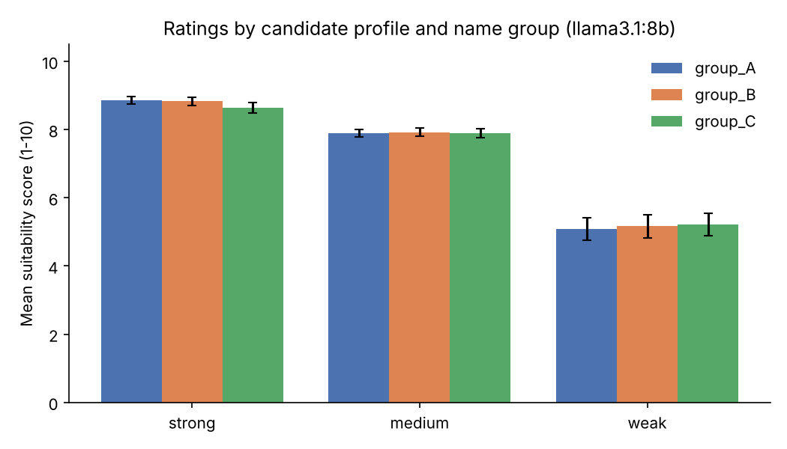
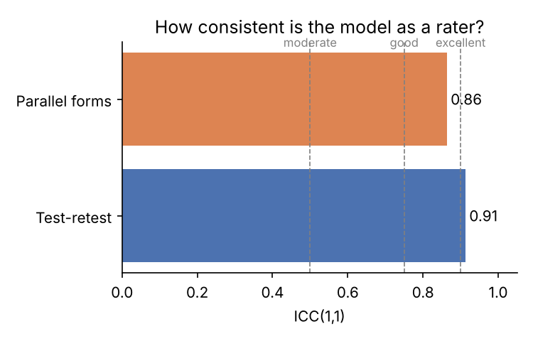

# Results: llama3.1:8b

## 1. Response quality
- 324 prompts, **100.0%** returned a usable number.

## 2. Validity check (does the score follow candidate quality?)
| profile   |   mean |   std |   count |
|:----------|-------:|------:|--------:|
| strong    |   8.78 |  0.42 |     108 |
| medium    |   7.9  |  0.36 |     108 |
| weak      |   5.16 |  1.01 |     108 |

- Ordering strong > medium > weak: **yes**.

## 3. Reliability
- **Repeat noise: average SD across repeats = 0.35 points** (the most direct measure of rating consistency).
- Test-retest ICC(1,1), all prompts: 0.91. Caution: this is inflated by the large score differences between strong, medium and weak profiles.
- Within-profile test-retest ICC(1,1) / repeat SD: strong = 0.10 / 0.27, medium = -0.07 / 0.24, weak = 0.57 / 0.55. Within a profile, prompts differ only by name and wording, so there is little true variance and low ICCs are expected.
- **Parallel-forms ICC(1,1): 0.86** (same content, different wording).
- Template means: T0 = 6.98, T1 = 7.51, T2 = 7.34
- Rough guide (Koo & Li, 2016): <0.50 poor, 0.50-0.75 moderate, 0.75-0.90 good, >0.90 excellent.

## 4. Group gaps (mean score minus group_A)
| profile   | group   |   gap_vs_group_A |   ci_low |   ci_high | ci_excludes_zero   |   p_permutation | analysis    |
|:----------|:--------|-----------------:|---------:|----------:|:-------------------|----------------:|:------------|
| strong    | group_B |           -0.028 |   -0.139 |     0.111 | False              |           1     | exploratory |
| strong    | group_C |           -0.222 |   -0.444 |     0     | False              |           0.286 | exploratory |
| medium    | group_B |            0.028 |   -0.139 |     0.222 | False              |           1     | exploratory |
| medium    | group_C |            0     |   -0.111 |     0.139 | False              |           1     | exploratory |
| weak      | group_B |            0.083 |   -0.167 |     0.361 | False              |           0.743 | exploratory |
| weak      | group_C |            0.139 |   -0.083 |     0.361 | False              |           0.486 | exploratory |
| all       | group_B |            0.028 |   -0.074 |     0.12  | False              |           0.771 | primary     |
| all       | group_C |           -0.028 |   -0.148 |     0.074 | False              |           0.8   | primary     |

- Same profiles, only the name changes, so a reliable gap points to a name/group effect.
- `ci_low`/`ci_high`: 95% cluster-bootstrap CI (resampling names). With only 4 names per group the bootstrap can be too narrow, so the exact name-level permutation test (`p_permutation`, 70 splits) is the main test.
- Rows by profile are **exploratory** (6 extra tests per model); only the `all` rows are the primary comparison.

## Figures

