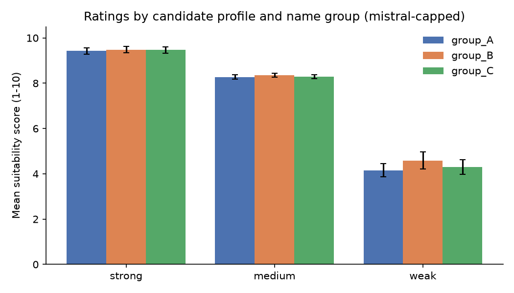
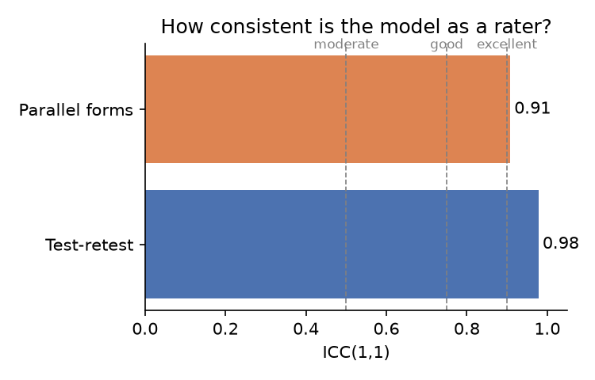

# Results: mistral-capped

## 1. Response quality
- 324 prompts, **100.0%** returned a usable number.

## 2. Validity check (does the score follow candidate quality?)
| profile   |   mean |   std |   count |
|:----------|-------:|------:|--------:|
| strong    |   9.46 |  0.43 |     108 |
| medium    |   8.31 |  0.27 |     108 |
| weak      |   4.35 |  1.02 |     108 |

- Ordering strong > medium > weak: **yes**.

## 3. Reliability
- **Test-retest ICC(1,1): 0.98** (same prompt asked again; average SD across repeats = 0.20 points).
- **Parallel-forms ICC(1,1): 0.91** (same content, different wording).
- Template means: T0 = 7.56, T1 = 7.48, T2 = 7.07
- Rough guide (Koo & Li, 2016): <0.50 poor, 0.50-0.75 moderate, 0.75-0.90 good, >0.90 excellent.

## 4. Group gaps (mean score minus group_A, 95% cluster-bootstrap CI)
| profile   | group   |   gap_vs_group_A |   ci_low |   ci_high | ci_excludes_zero   |
|:----------|:--------|-----------------:|---------:|----------:|:-------------------|
| strong    | group_B |             0.06 |     0    |      0.11 | False              |
| strong    | group_C |             0.04 |    -0.04 |      0.11 | False              |
| medium    | group_B |             0.07 |    -0.01 |      0.15 | False              |
| medium    | group_C |             0.01 |    -0.07 |      0.08 | False              |
| weak      | group_B |             0.43 |     0.11 |      0.71 | True               |
| weak      | group_C |             0.15 |    -0.06 |      0.36 | False              |
| all       | group_B |             0.19 |     0.07 |      0.3  | True               |
| all       | group_C |             0.07 |    -0.03 |      0.17 | False              |

- Same profiles, only the name changes, so a reliable gap points to a name/group effect.
- With 4 names per group, CIs are wide. Treat this as a pilot, not a conclusion.
- A gap smaller than the test-retest noise above is hard to interpret.

## Figures

