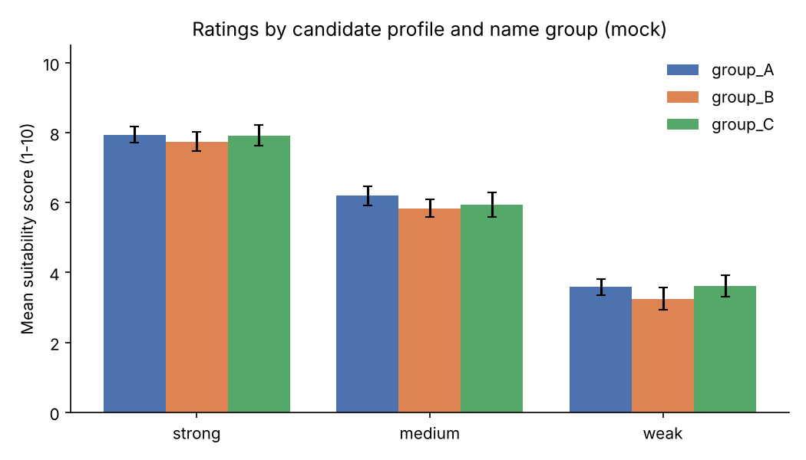
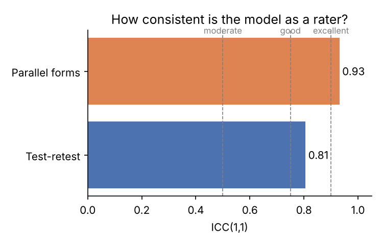

# Results: mock

> **Mock run.** These numbers come from a simulated rater with a built-in effect, used only to test the pipeline. They are not findings about any LLM.

## 1. Response quality
- 324 prompts, **100.0%** returned a usable number.

## 2. Validity check (does the score follow candidate quality?)
| profile   |   mean |   std |   count |
|:----------|-------:|------:|--------:|
| strong    |   7.87 |  0.82 |     108 |
| medium    |   5.99 |  0.91 |     108 |
| weak      |   3.48 |  0.89 |     108 |

- Ordering strong > medium > weak: **yes**.

## 3. Reliability
- **Repeat noise: average SD across repeats = 0.77 points** (the most direct measure of rating consistency).
- Test-retest ICC(1,1), all prompts: 0.81. Caution: this is inflated by the large score differences between strong, medium and weak profiles.
- Within-profile test-retest ICC(1,1) / repeat SD: strong = 0.01 / 0.72, medium = -0.02 / 0.82, weak = -0.04 / 0.77. Within a profile, prompts differ only by name and wording, so there is little true variance and low ICCs are expected.
- **Parallel-forms ICC(1,1): 0.93** (same content, different wording).
- Template means: T0 = 5.75, T1 = 5.80, T2 = 5.80
- Rough guide (Koo & Li, 2016): <0.50 poor, 0.50-0.75 moderate, 0.75-0.90 good, >0.90 excellent.

## 4. Group gaps (mean score minus group_A)
| profile   | group   |   gap_vs_group_A |   ci_low |   ci_high | ci_excludes_zero   |   p_permutation | analysis    |
|:----------|:--------|-----------------:|---------:|----------:|:-------------------|----------------:|:------------|
| strong    | group_B |           -0.194 |   -0.417 |     0.028 | False              |           0.229 | exploratory |
| strong    | group_C |           -0.028 |   -0.472 |     0.333 | False              |           1     | exploratory |
| medium    | group_B |           -0.361 |   -0.584 |    -0.139 | True               |           0.057 | exploratory |
| medium    | group_C |           -0.25  |   -0.528 |     0     | False              |           0.286 | exploratory |
| weak      | group_B |           -0.333 |   -0.639 |    -0.056 | True               |           0.2   | exploratory |
| weak      | group_C |            0.028 |   -0.278 |     0.389 | False              |           1     | exploratory |
| all       | group_B |           -0.296 |   -0.5   |    -0.111 | True               |           0.057 | primary     |
| all       | group_C |           -0.083 |   -0.231 |     0.056 | False              |           0.486 | primary     |

- Same profiles, only the name changes, so a reliable gap points to a name/group effect.
- `ci_low`/`ci_high`: 95% cluster-bootstrap CI (resampling names). With only 4 names per group the bootstrap can be too narrow, so the exact name-level permutation test (`p_permutation`, 70 splits) is the main test.
- Rows by profile are **exploratory** (6 extra tests per model); only the `all` rows are the primary comparison.

## Figures

