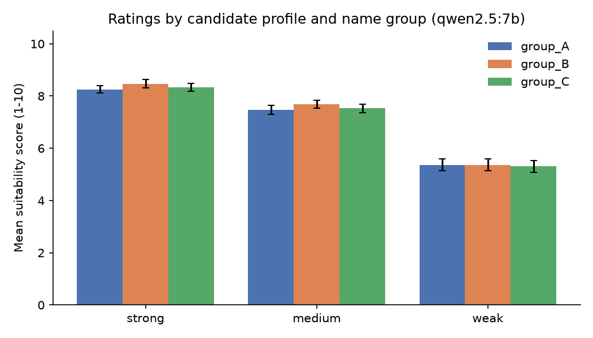
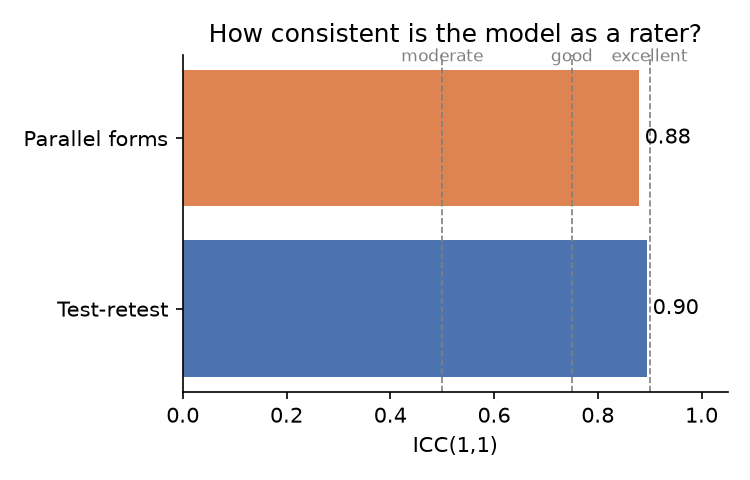

# Results: qwen2.5:7b

## 1. Response quality
- 324 prompts, **100.0%** returned a usable number.

## 2. Validity check (does the score follow candidate quality?)
| profile   |   mean |   std |   count |
|:----------|-------:|------:|--------:|
| strong    |   8.35 |  0.48 |     108 |
| medium    |   7.56 |  0.5  |     108 |
| weak      |   5.34 |  0.69 |     108 |

- Ordering strong > medium > weak: **yes**.

## 3. Reliability
- **Test-retest ICC(1,1): 0.90** (same prompt asked again; average SD across repeats = 0.35 points).
- **Parallel-forms ICC(1,1): 0.88** (same content, different wording).
- Template means: T0 = 7.28, T1 = 7.32, T2 = 6.66
- Rough guide (Koo & Li, 2016): <0.50 poor, 0.50-0.75 moderate, 0.75-0.90 good, >0.90 excellent.

## 4. Group gaps (mean score minus group_A, 95% cluster-bootstrap CI)
| profile   | group   |   gap_vs_group_A |   ci_low |   ci_high | ci_excludes_zero   |
|:----------|:--------|-----------------:|---------:|----------:|:-------------------|
| strong    | group_B |             0.22 |     0.03 |      0.42 | True               |
| strong    | group_C |             0.08 |    -0.06 |      0.22 | False              |
| medium    | group_B |             0.22 |     0.06 |      0.39 | True               |
| medium    | group_C |             0.06 |    -0.11 |      0.25 | False              |
| weak      | group_B |             0    |    -0.33 |      0.31 | False              |
| weak      | group_C |            -0.06 |    -0.36 |      0.22 | False              |
| all       | group_B |             0.15 |     0.01 |      0.26 | True               |
| all       | group_C |             0.03 |    -0.11 |      0.16 | False              |

- Same profiles, only the name changes, so a reliable gap points to a name/group effect.
- With 4 names per group, CIs are wide. Treat this as a pilot, not a conclusion.
- A gap smaller than the test-retest noise above is hard to interpret.

## Figures

